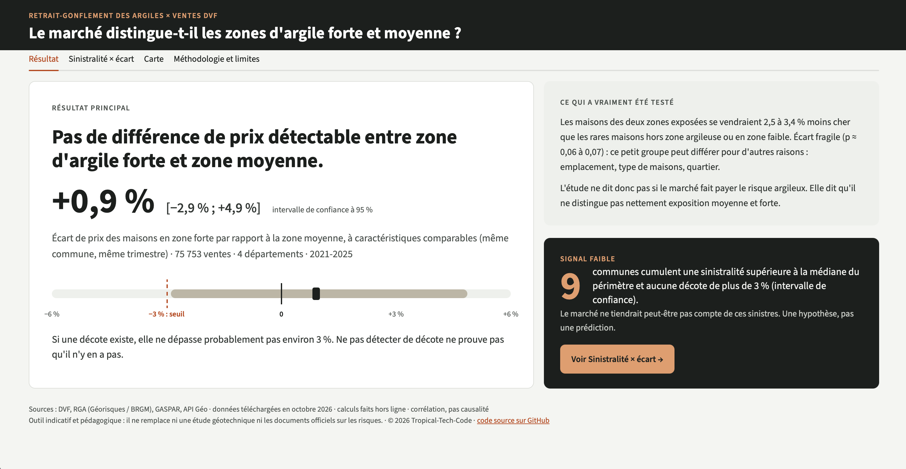
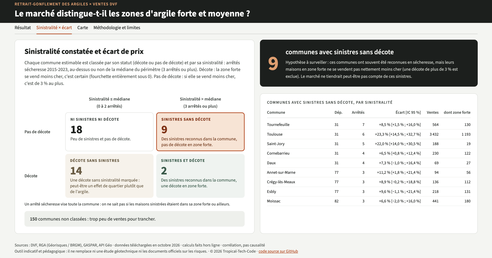
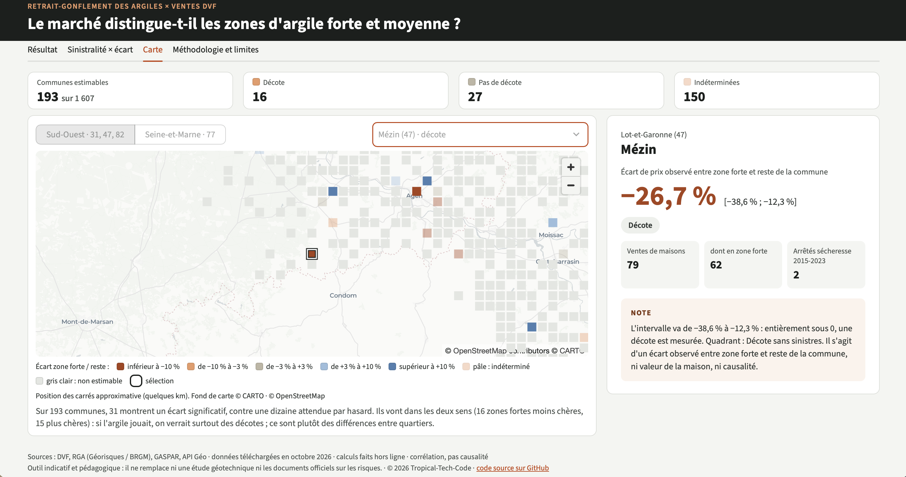
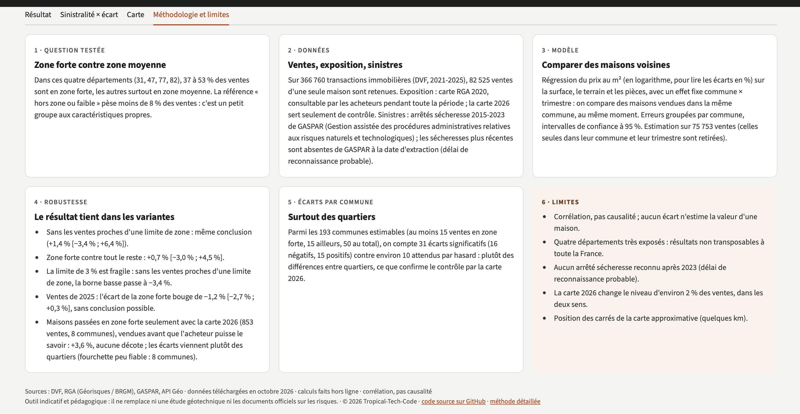

# Retrait-Gonflement

Les maisons situées en zone d'argile à forte exposition au retrait-gonflement se vendent-elles moins cher que celles situées en zone d'exposition moyenne ? Une étude de données alternatives sur les ventes de maisons de quatre départements (Haute-Garonne, Lot-et-Garonne, Seine-et-Marne, Tarn-et-Garonne), croisées avec les cartes d'exposition et les arrêtés de catastrophe naturelle « sécheresse ».

**Démo : <https://retrait-gonflement.streamlit.app>**

## Le résultat en bref

- **Pas de différence de prix détectable entre zone forte et zone moyenne.** Le contraste fort − moyen est de +0,9 % [−2,9 % ; +4,9 %] (p = 0,64), sur 75 753 ventes de 2021 à 2025 dans 1 276 communes. L'intervalle de confiance (IC) est à 95 %.
- **Si une décote existe, elle ne dépasse probablement pas environ 3 %.** Ne pas détecter de décote ne prouve pas qu'il n'y en a pas.
- **Par commune**, l'écart de prix observé entre la zone forte et le reste de la commune n'est estimable que pour 193 communes. Parmi elles, 150 restent indéterminées (intervalle trop large pour conclure), 16 montrent une décote et 27 aucune décote de plus de 3 %.
- **Les écarts communaux ressemblent plutôt à des différences entre quartiers.** Seize communes ont un écart négatif significatif et quinze un écart positif significatif, contre environ dix attendues par hasard en tout : l'excès est symétrique, il ne signale pas une décote générale.
- **Une hypothèse à surveiller, au conditionnel.** Neuf communes cumulent des sinistres reconnus (trois arrêtés « sécheresse » ou plus entre 2015 et 2023, au-dessus de la médiane du périmètre) et aucune décote de plus de 3 %. Les marchés de ces communes pourraient ne pas avoir intégré le risque ; c'est une piste, pas une prédiction.
- **Contre les maisons hors zone argileuse ou en zone faible**, l'écart estimé est d'environ −3,4 % en zone moyenne et −2,5 % en zone forte (p = 0,06 et p = 0,07), non significatif au seuil de 5 %. Ce groupe de référence est petit et particulier : ce résultat fragile ne permet pas de dire si le marché fait payer le risque argileux.

## La question

La question de départ était celle d'une prime de risque implicite sur l'argile. Elle ne peut pas être tranchée ici : l'étude compare deux zones déjà exposées, forte et moyenne, et ne trouve pas de différence entre elles. Le résultat global est donc le contraste fort − moyen. Par commune, on parle d'écart de prix observé entre la zone forte et le reste de la commune, sans lien de causalité établi.

## Aperçu


*Résultat : la réponse en une phrase, le contraste fort − moyen et ce qui a vraiment été testé.*


*Sinistralité × écart : les communes classées selon l'historique d'arrêtés et la présence d'une décote.*


*Carte : un carré par commune, coloré selon le statut de l'écart, avec une fiche par commune.*


*Méthodologie et limites : six cartes courtes sur les données, le modèle et ses limites.*

## Données

| Source | Producteur | Date de téléchargement | Licence |
|---|---|---|---|
| Demandes de valeurs foncières (DVF) géolocalisées, ventes 2021-2025 | Direction générale des Finances publiques (DGFiP), géolocalisation Etalab | 15/10/2026 | [Licence Ouverte 2.0](https://www.etalab.gouv.fr/licence-ouverte-open-licence) |
| Carte d'exposition au retrait-gonflement des argiles (RGA) 2020 | Géorisques / Bureau de recherches géologiques et minières (BRGM) | 16/10/2026 (dépôt manuel) | [Licence Ouverte 2.0](https://www.etalab.gouv.fr/licence-ouverte-open-licence) |
| Carte d'exposition RGA 2026 | Géorisques / BRGM | 15/10/2026 (dépôt manuel) | [Licence Ouverte 2.0](https://www.etalab.gouv.fr/licence-ouverte-open-licence) |
| Gestion assistée des procédures administratives relatives aux risques (GASPAR), arrêtés de catastrophe naturelle (CatNat) | Géorisques | extraction du 5 octobre 2026, téléchargée le 16/10/2026 | [Licence Ouverte 2.0](https://www.etalab.gouv.fr/licence-ouverte-open-licence) |
| Contours des communes (API Géo, issus d'ADMIN EXPRESS) | Institut national de l'information géographique et forestière (IGN) | 16/10/2026 | [Licence Ouverte 2.0](https://www.etalab.gouv.fr/licence-ouverte-open-licence) |

La carte 2020 est celle dont disposait le marché pendant toute la période étudiée ; la carte 2026 sert seulement de contrôle.

## Méthode

- Seules les ventes simples d'une maison sont gardées, après nettoyage de DVF et exclusion des valeurs aberrantes.
- Chaque vente reçoit le niveau d'exposition de la carte 2020 par jointure spatiale : hors zone argileuse, faible, moyen ou fort.
- Une régression du prix au m² (log), avec surface, terrain, nombre de pièces et un effet fixe commune × trimestre, compare des maisons vendues dans la même commune le même trimestre. Les erreurs sont groupées par commune.
- Le chiffre principal est le contraste fort − moyen, entre deux groupes nombreux et proches.
- Par commune, un terme « fort contre tout le reste » est estimé, avec des erreurs groupées par section cadastrale, puis un statut : décote, pas de décote ou indéterminé.
- Les communes classées sont croisées avec leur nombre d'arrêtés « sécheresse » depuis 2015, comparé à la médiane du périmètre.
- Le nombre de communes significatives est comparé au nombre attendu par hasard.

Le détail (seuils, définitions, variantes de contrôle) est dans [`docs/method.md`](docs/method.md).

## Limites

- **Corrélation, pas causalité** : la géologie suit le relief, qui joue aussi sur le prix au sein d'une commune. L'étude n'estime la valeur d'aucune maison.
- **Deux zones exposées comparées** : la zone de référence de l'écart par commune est très majoritairement « moyen ». La comparaison avec une zone sans exposition repose sur un petit groupe (moins de 8 % des ventes).
- **Tests multiples** : chaque commune estimable est un test à 95 %, donc quelques communes paraissent significatives par hasard. Une commune isolée n'est pas une preuve.
- **Écarts entre quartiers** : l'excès symétrique de communes significatives et le fait que les décotes se trouvent surtout dans des communes peu sinistrées vont dans le sens d'écarts de quartiers au sein des communes.
- **Sinistralité** : les arrêtés couvrent 2015-2023 (aucune sécheresse n'est reconnue après 2023) et concernent toute la commune, pas seulement sa zone forte.
- **Précision des cartes** : la carte est établie au 1/50 000 et le point d'une vente est le centroïde de sa parcelle ; des ventes proches d'une limite peuvent être mal classées.
- **Périmètre** : maisons uniquement, quatre départements, ventes de 2021 à 2025. L'écart propre aux ventes de 2025 est un simple indice (une seule année).

## Avertissement

Outil indicatif et pédagogique : il ne remplace ni une étude géotechnique ni les documents officiels sur les risques.

## Reproduire

Prérequis : Python 3.11 et [uv](https://docs.astral.sh/uv/). Aucune clé n'est nécessaire.

```
uv sync
```

`uv sync` installe les dépendances de l'application, plus les groupes `pipeline` (httpx, duckdb, pyfixest, scipy) et `dev` (pytest). L'application déployée n'utilise que les dépendances principales : `app/requirements.txt` sert au déploiement et se régénère, après tout changement de ces dépendances, avec `uv export --frozen --no-default-groups --no-hashes --no-emit-project --output-file app/requirements.txt`.

La jointure spatiale a besoin de l'extension `spatial` de DuckDB, à installer une fois :

```
uv run python -c "import duckdb; duckdb.sql('INSTALL spatial')"
```

### Récupération des données

DVF, les contours des communes et GASPAR se téléchargent par commande :

```
uv run python -m retrait_gonflement.data.dvf
uv run python -m retrait_gonflement.data.communes
uv run python -m retrait_gonflement.data.gaspar
```

Chaque commande accepte `--ecraser` pour retélécharger un fichier déjà présent ; DVF et les contours acceptent aussi `--departement` (par exemple `--departement 82`), DVF `--annee`.

Les cartes d'exposition RGA n'ont pas d'URL stable (formulaire Géorisques) : elles se déposent à la main.

1. Sur [Géorisques](https://www.georisques.gouv.fr/donnees/bases-de-donnees/retrait-gonflement-des-argiles), télécharger pour chaque département étudié (31, 47, 77, 82) le Shapefile en Lambert 93 de la carte d'exposition.
2. Déposer chaque archive `.zip` telle quelle (sans la renommer ni la décompresser) dans `data/raw/rga/2026/` pour la carte 2026, par exemple `AleaRG_2025_31_L93.zip`, ou dans `data/raw/rga/2020/` pour la carte 2020, par exemple `AleaRG31_L93.zip`.
3. Vérifier le dépôt : `uv run python -m retrait_gonflement.data.rga --millesime 2026`. La commande signale les départements manquants et les archives incomplètes (il faut les 5 fichiers `.shp`, `.shx`, `.dbf`, `.prj`, `.cpg`).

### Pipeline

À lancer dans cet ordre ; les résultats finaux sont écrits dans `data/processed/`.

```
uv run python -m retrait_gonflement.data.nettoyage_dvf
uv run python -m retrait_gonflement.spatial.jointure_rga
uv run python -m retrait_gonflement.model.modele_global
uv run python -m retrait_gonflement.model.primes_communes
uv run python -m retrait_gonflement.model.communes_finales
uv run python -m retrait_gonflement.model.metadonnees
uv run python -m retrait_gonflement.spatial.carres
```

### Application et tests

```
uv run streamlit run app/streamlit_app.py
uv run pytest
```

Les tests n'appellent aucun réseau : ils utilisent des réponses simulées (`tests/fixtures/`) et de petites données construites sur place.

## Structure du dépôt

```
src/retrait_gonflement/  paquet Python
  data/                  collecte et nettoyage (DVF, RGA, GASPAR, communes)
  spatial/               jointures spatiales, contours, carrés de la carte
  model/                 régression, écarts par commune, fichiers finaux
app/                     application Streamlit (lit uniquement data/processed/)
tests/                   tests pytest
docs/                    method.md (méthode), app.md (spécification), captures/
config/                  perimetre.toml (départements, années, URL, seuils)
data/raw/                données brutes (ignorées par Git)
data/interim/            ventes nettoyées et base de travail (ignorées par Git)
data/processed/          agrégats par commune lus par l'application
```

## Confidentialité

`data/processed/` ne contient que des agrégats par commune : aucune vente individuelle n'est publiée. Les données brutes et intermédiaires ne sont pas versionnées. L'application déployée ne lit que `data/processed/` : aucun appel réseau.

## Méthode de travail

Le projet est conçu et piloté par Tropical-Tech-Code : question, méthode statistique, périmètre, arbitrages, vérification des résultats et des sources. Le code a été écrit avec l'assistance de Claude Code (Anthropic), sous relecture, avec des tests automatisés et une validation de chaque étape.

## Licence

Le code est sous [licence MIT](LICENSE). Les données restent sous la Licence Ouverte 2.0 de leurs producteurs.

Le dépôt est archivé sur Software Heritage : [`swh:1:snp:980450b148e483a6829819b3b15da26d6f5cbe65`](https://archive.softwareheritage.org/swh:1:snp:980450b148e483a6829819b3b15da26d6f5cbe65).
